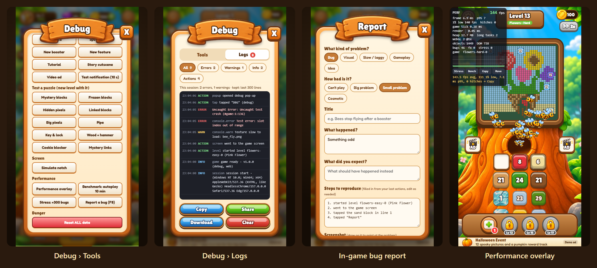

# 🐝 Pixel Swarm

A cute casual puzzle game for mobile and web. Tiny bugs live inside the magical **Art-Tree**: send them out, color by color, to eat pixel-art pictures. Bugs can only reach what is uncovered, so the order you pick colors in is the whole puzzle.

**▶ Play in your browser:** https://heloisatorres1.github.io/pixel-swarm/


## About this project

A portfolio project by **Heloisa Oller Torres**, QA Test Lead / Senior QA for games and software · [LinkedIn](https://www.linkedin.com/in/heloisa-torres-94250814a) · [GitHub](https://github.com/heloisatorres1)

I've worked in game QA for 6+ years on live-service and in-development titles (PC, mobile, web). Most recently I was Test Lead at Fortis Games, leading internal and external QA teams across Unity, Godot and web games. I'm ISTQB CTFL certified.

For Pixel Swarm I wrote the [game concept document](docs/game-concept.pdf) (competitor research, screen sketches, puzzle mechanics and monetization), directed the art and owned the product end to end, from concept and level design to release on the web and a native Android build. Development was AI-assisted under my direction. Quality was built in from the start, the same way I work as a Test Lead: a test strategy for every system, automated checks that prove the game works, and clear evidence of what they caught (see [Quality & testing](#quality--testing)).

## Features

- **Core loop:** tap colored blocks into a few slots; bugs fly out of the tree, eat the matching pixels and carry them home. Fill every slot with colors that can't be reached and you're out of slots.
- **102 levels, each with its own pixel-art picture:** 5 themes × 18 levels (6 Easy, 6 Medium, 6 Hard) plus a 12-level **Halloween event** with a pumpkin reward track. Easy pictures are simple 12×12 subjects, Hard ones are detailed 18×18 scenes ([all pictures](docs/screenshots/levels-overview.png)).
- **10 puzzle mechanics**, introduced one by one with a "New Feature" card: mystery blocks, frozen blocks (ice counter), linked blocks, mystery links, pipes, keys & locks, wood blocks + hammers, cookie blockers, big pixels and hidden pixels.
- **Boosters:** Add Slot, Shuffle (never leaves you stuck), Wind, Free Pick; rewarded ad slots.
- **Ads and purchases are simulated, by design:** the whole monetization flow works (rewarded ad slots, free coins, x2 rewards, an ad every few wins, banners, No Ads and store purchases), but ads are "house ads" promoting the game's own features and purchases are test purchases. `showAd` / `renderAdBanner` and `buy` in `js/app.js` are the points where a real ad network and app-store billing would connect.
- **Meta systems:** store and speed store, daily rewards and tasks, stat-based achievements, a gallery of every level, a skins wardrobe (6 bugs × 7 looks), profile, story cutscene, guided first level, age gate and special offers.
- **Music and sound effects** synthesized live with the Web Audio API (no audio files), paired with **haptics** (success / warning / error patterns on phones).
- **Reliable saving:** two save slots (a broken write never loses progress), saving when the game goes to the background, durable app storage on Android, and **save codes** (attached to bug reports; testers load them from the debug menu to reproduce a player's exact progress).
- **Sharing:** finished pictures become a share card (picture + link) for the phone's share sheet.
- **In-game report tool** (Settings › Report, or F8): type, how bad it is (mapped to Blocker / Major / Minor / Trivial), title, what happened, what was expected and **steps to reproduce pre-filled from the player's last actions**. It attaches a **screenshot** of the moment (the reporter can draw on it), the game state (level, slots, pixels left…), build and device, performance numbers, recent errors and, optionally, a save code to load the exact progress. No personal data. **Send is simulated** (there is no server): the full report is built as it would be uploaded and logged in the debug Logs tab.
- **Logs tab** in the debug menu: every error (uncaught exceptions with file and line, rejected promises, console errors), warning, info line and player action, with filters and a red error count on the DBG button. The last 300 lines are kept across reloads, so a crash's log can still be read after restarting; copy, share or download it as text.
- **Reminders (Android):** daily reward, "your bugs miss you" and event-ending notifications, with permission asked after the first win, not at launch.

## Quality & testing

The levels are generated procedurally, so "it looks fine" isn't enough: every level and mechanic is checked automatically with the game's own rules. Each check runs in the browser from a URL shortcut and also runs headless.

| Check | What it proves |
|---|---|
| `#verify_all` (level checker) | All **102 levels are solvable**: each one is played instantly in solution order with the real rules. Also reports a **careless-player win rate** per difficulty against design targets, whether each puzzle type can be placed in every level, and visual rules (e.g. never two hidden "?" blocks in one column). |
| `#pzsolve_<puzzle>` (playthroughs) | A bot plays a level with each puzzle **through the real animated game loop** until it wins. This caught a desync between the instant checker and the animated game that only showed up with the cookie blocker. |
| `#featuretest` (simulated phone) | Checks saving (backup slot, recovery from a corrupted save, save codes), sharing (share sheet and fallback), vibration patterns and the notification schedule against **fake phone plugins** that record every call, so phone features are tested without a phone. |
| `#clicktest` (real taps) | Taps puzzle tiles and the skins purchase flow **through the page, like a finger**. It caught a tap-handling clash that the bots (which call game functions directly) could not see. |
| `tools/check-pictures.mjs` | Every level picture: right size, allowed colors, color count per difficulty, no two colors that look alike (CIELAB ΔE < 25) or close to the board, no repeats, no name clashes. Renders a preview sheet of all 102 pictures. |
| Layout probes and screenshots | Layout and "fits without scrolling" checks at several phone sizes; headless screenshots to compare screens against the design references. **Safe areas** (notch, rounded corners, home bar) are tested on a computer with a simulated notch (Debug › Simulate notch, or the `-notch` URL suffix); on short phones the game screen shrinks the parts under the picture so nothing goes off screen. |
| `#reporttest` (report tool) | Plays a move, causes an error, opens the report from Settings and checks what a report holds: the screenshot really contains the gameplay layer (not a blank WebGL canvas), steps are pre-filled, game state, captured errors, save code, that a title is required and that Send builds and logs the report. |
| Performance debug (`#perf`, `#perfbench`, `#perfstress`) | A live overlay (FPS, 1% low, frame-time graph, game-loop and render cost, memory, long tasks, scene and DOM counts) and a stress test (300 or 1000 extra bugs). The **benchmark lets the game play itself for 10 minutes**, level after level across every theme and difficulty, then reports frame-time percentiles, hitches, a **per-minute timeline** and a **memory-leak check** (heap, DOM and scene growth per minute), ready to copy into a bug ticket. The player's save is frozen during the run and restored after. `#perfbench_60` runs a shorter version headless. |
| `PSAudio.measure()` | Renders the music and effects offline and measures their loudness, to balance the mix without relying on speakers. |

### End-to-end test (Playwright + TypeScript)

`tests/e2e/complete-medium-level.spec.ts` plays the game **only through real clicks on the page**: it opens the game as a returning player (Easy levels already finished, loaded as test data), starts **Flowers - Medium level 1**, plays it to the end (handling Medium mechanics such as linked and mystery blocks), then checks the "Level Complete" pop-up, the coin reward and that the win is saved (Medium stars, next level unlocked). Breaking the coin reward in the game makes it fail, so it catches real regressions. It uses a page object (`tests/e2e/pages/GamePage.ts`) and runs in a visible, phone-sized browser; every run saves a video.

```bash
npx playwright install chromium   # once
npm run test:e2e                  # visible browser; HEADLESS=1 npm run test:e2e for a hidden one
npm run test:e2e:report           # HTML report with steps, screenshots and video
```

### Debug & QA tools in the game



The **DBG** button opens a debug menu built for testers, not just for development:

- **Tools tab:** cheats to reach any state fast (win/lose/auto-solve a level, currencies, unlocks, progress), every pop-up on demand, a fresh level for each of the 10 puzzle mechanics, a notch simulator for safe-area checks, the performance tools, and save codes to copy a player's progress or load a tester's.
- **Logs tab:** errors, warnings, info and player actions with filters, a red error count on the DBG button, and copy / share / download, so a crash log can be attached to a ticket even after a restart.
- **Bug report (Settings › Report or F8):** severity in QA terms, steps to reproduce pre-filled from the last actions, an annotated screenshot, game state, device, performance and logs in one report.
- **Performance overlay and benchmark:** live frame-time, memory and render numbers; a stress test; and a 10-minute self-playing benchmark with a per-minute timeline and leak check.

The GitHub Pages demo keeps the **debug menu on** so this tooling can be explored; the official itch.io release turns it off. The URL shortcuts above work in both.

## Tech

| | |
|---|---|
| Rendering | Hybrid: **PixiJS 8** (WebGL) draws the gameplay (picture board, flying bugs, effects); menus, store and pop-ups are HTML/CSS. Falls back to a 2D canvas without WebGL |
| Code | Vanilla JavaScript, no framework or bundler (~5k lines) |
| Audio | Web Audio API: two music loops and ~18 synthesized sound effects |
| Native | Capacitor → Android, with haptics and local notifications |
| Build & deploy | Node build scripts → `dist/`; GitHub Actions publishes to GitHub Pages on every push to `main` |
| Art | AI-generated images, art-directed and processed with the PowerShell tools in `tools/` |

## Run locally

```bash
npm install
npm run dev        # http://localhost:5173
```

Useful shortcuts (add to the URL): `#game`, `#game_hard`, `#events`, `#skins`, `#puzzle_key`, `#autoplay`, `#verify_all`, `#clicktest`.

## Build

```bash
npm run build          # release build → dist/
npm run build:debug    # same, with the debug menu on (used for GitHub Pages)
npm run package:itch   # zip for itch.io (HTML5)
npm run android:sync   # build + copy into the Android project
npm run android:open   # open in Android Studio
```

## Project structure

```
index.html, css/, js/, assets/   the game
scripts/                         build, dev server, itch packaging
tests/e2e/                       Playwright end-to-end tests (TypeScript)
tools/                           sprite cutting and slicing tools (PowerShell)
docs/                            game concept document, competitor level study, screenshots
android/                         Capacitor Android project
```

## Credits

See [CREDITS.md](CREDITS.md).
