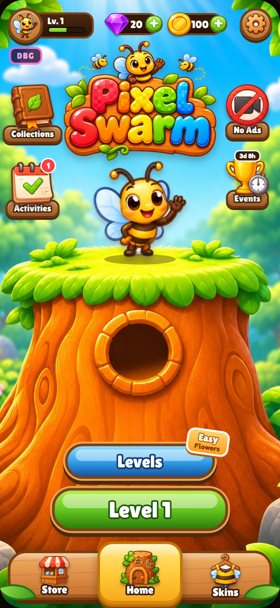

# 🐝 Pixel Swarm

A cute casual puzzle game for mobile and web. Tiny bugs live inside the magical **Art-Tree**: send them out, color by color, to eat pixel-art pictures — but bugs can only eat what is uncovered from below, so the order matters.

**▶ Play in your browser:** https://heloisatorres1.github.io/pixel-swarm/ · itch.io: _coming soon_



## Features

- **Core loop** — tap colored blocks into limited slots; bugs fly out of the tree, eat the matching pixels and carry them home.
- **5 themes × 15 levels** (Easy → Medium → Hard) plus a **12-level Halloween event** with a pumpkin reward track.
- **Procedural difficulty** — 12×12 pictures are upscaled (Scale2x/Scale3x) and shaded for Medium/Hard; colors are kept perceptually distinct (CIELAB ΔE ≥ 25).
- **Always solvable** — levels are generated from a recorded winning order; a built-in checker verifies all 87 levels (`index.html#verify_all`).
- **Puzzles & boosters** — mystery and frozen blocks, Add Slot, Shuffle (never leaves you stuck), Wind, Free Pick; AD slots.
- **Meta systems** — store, speed store (time boosts + permanent speeds), daily rewards & tasks, achievements, gallery, skins, profile, age gate, special offers.
- **Player aids** — faded blocks show colors that can't be eaten yet; tap a waiting slot to see what's in the way.
- Debug/cheat menu in development builds.

## Tech

| | |
|---|---|
| Rendering | HTML/CSS UI + `<canvas>` game board (pixel-exact, DPR-aware) |
| Code | Vanilla JavaScript (no framework), ~2k lines |
| Build | Node scripts → `dist/` (release builds disable the debug menu) |
| Web | GitHub Pages (GitHub Actions) · itch.io (HTML5 zip) |
| Mobile | Capacitor → Android (iOS possible with a Mac) |
| Art | AI-generated sprite sheets (ChatGPT) sliced with custom tools in `tools/` |

## Run locally

```bash
npm install
npm run dev        # http://localhost:5173
```

Dev shortcuts: `#game`, `#game_medium`, `#game_hard`, `#events`, `#autoplay`, `#solve_hard`, `#verify_all`.

## Build & publish

```bash
npm run build          # release build → dist/
npm run package:itch   # → release/pixel-swarm-itch-vX.Y.Z.zip (upload to itch.io as HTML)
npm run android:sync   # build + copy into the Android project
npm run android:open   # open in Android Studio → Run ▶ or Build › Generate Signed Bundle/APK
```

GitHub Pages deploys automatically on every push to `main` (`.github/workflows/deploy-pages.yml`).

## Project structure

```
index.html, css/, js/, assets/   the game
scripts/                         build, dev server, itch packaging
tools/                           sprite-sheet slicer & cut-out tools (PowerShell)
prompts/                         ChatGPT prompts used for the art
docs/                            competitor study, screenshots
android/                         Capacitor Android project
```

## Credits

See [CREDITS.md](CREDITS.md). Game design document and art direction by the author.
